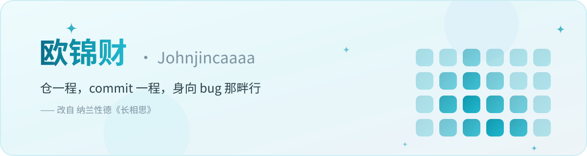

<!--
  ═══════════════════════════════════════════════════════════════════════
  欧锦财 · Johnjincaaaa

  山一程，水一程，身向榆关那畔行，夜深千帐灯。
  逆一程，commit 一程，身向 Wasm 那畔行，夜深屏幕灯。
  ═══════════════════════════════════════════════════════════════════════
-->

<div align="center">

<picture>
  <source media="(prefers-color-scheme: dark)" srcset="assets/hero-dark.svg">
  
</picture>

<a href="[https://github.com/](https://github.com/)你的用户名">
  <picture>
    <source media="(prefers-color-scheme: dark)" srcset="[https://readme-typing-svg.demolab.com?font=ZCOOL+KuaiLe&amp;size=24&amp;duration=3200&amp;pause=700&amp;color=22D3EE&amp;center=true&amp;vCenter=true&amp;width=760&amp;height=52&amp;lines=%E9%80%86%E4%B8%80%E7%A8%8B%EF%BC%8Ccommit%20%E4%B8%80%E7%A8%8B;%E8%BA%AB%E5%90%91%20Wasm%20%E9%82%A3%E7%95%94%E8%A1%8C;%E5%A4%9C%E6%B7%B1%E5%8D%83%E5%B8%90%E7%81%AF%EF%BC%8C%E6%88%91%E8%BF%99%E5%84%BF%E4%B8%80%E7%9B%8F;%E8%AE%A9%20Agent%20%E6%9B%BF%E6%88%91%E5%B9%B2%E6%B4%BB%EF%BC%8C%E5%AE%83%E4%B9%9F%E5%9C%A8%E8%AE%A9%20AI%20%E6%9B%BF%E5%AE%83%E5%B9%B2%E6%B4%BB;%E4%BB%A3%E7%A0%81%E5%86%99%E5%BE%97%E4%B8%8D%E5%A4%9A%EF%BC%8C%E9%80%86%E5%87%BA%E5%8F%8D%E6%94%BE%E6%8C%BA%E5%8B%A4](https://readme-typing-svg.demolab.com?font=ZCOOL+KuaiLe&amp;size=24&amp;duration=3200&amp;pause=700&amp;color=22D3EE&amp;center=true&amp;vCenter=true&amp;width=760&amp;height=52&amp;lines=%E9%80%86%E4%B8%80%E7%A8%8B%EF%BC%8Ccommit%20%E4%B8%80%E7%A8%8B;%E8%BA%AB%E5%90%91%20Wasm%20%E9%82%A3%E7%95%94%E8%A1%8C;%E5%A4%9C%E6%B7%B1%E5%8D%83%E5%B8%90%E7%81%AF%EF%BC%8C%E6%88%91%E8%BF%99%E5%84%BF%E4%B8%80%E7%9B%8F;%E8%AE%A9%20Agent%20%E6%9B%BF%E6%88%91%E5%B9%B2%E6%B4%BB%EF%BC%8C%E5%AE%83%E4%B9%9F%E5%9C%A8%E8%AE%A9%20AI%20%E6%9B%BF%E5%AE%83%E5%B9%B2%E6%B4%BB;%E4%BB%A3%E7%A0%81%E5%86%99%E5%BE%97%E4%B8%8D%E5%A4%9A%EF%BC%8C%E9%80%86%E5%87%BA%E5%8F%8D%E6%94%BE%E6%8C%BA%E5%8B%A4)">
    
  </picture>
</a>

<br>

<a href="[https://github.com/](https://github.com/)你的用户名?tab=followers"></a>
<a href="[https://github.com/](https://github.com/)你的用户名?tab=repositories"></a>


</div>

---

## `$ whoami`

```bash
$ whoami
欧锦财 —— 但 GitHub 上叫我 Johnjincaaaa

$ cat ~/.signature
山一程，水一程，身向榆关那畔行，夜深千帐灯。

$ echo $MY_VERSION
逆一程，commit 一程，身向 Wasm 那畔行，夜深屏幕灯。

$ sudo rm -rf 摸鱼
rm: cannot remove '摸鱼': No such file or directory
# 不是因为我勤奋
# 是因为我把「摸鱼」这件事本身，也写成了自动化脚本

$ git log -1 --pretty=%s
fix: 签名通了，但加密逻辑我还没完全看懂
```

## 关于我 · About

主攻 Python / JS 逆向，痴迷爬虫与Web安全，现在一头扎进 AI Agent 的世界。

我信一条很朴素的原则：**一件重复的事，就交给自动化与Agent去扛；挡在前面的加密，就慢慢拆解。**
于是写过爬虫、JS混淆解混淆、Wasm逆向、语音TTS服务、向量长期记忆、陪伴数字人Jingent……

结果是我花在维护Agent、调试签名、对抗反爬的时间，比写业务本身还要多。

朋友说这叫「用战术上的勤奋掩盖战略上的懒惰」。
我说这叫热爱，谢谢。

理想是让Agent替我干活，现实是我天天给Agent修bug、调记忆、改提示词。
但至少——Agent不会在周五下午六点临时改签名算法。
2028届在校生，目标AI方向实习与校招。

---

## 这一年都在忙什么 · Activity

  
    
    你的用户名&show_icons=true&hide_border=true&include_all_commits=true&count_private=true&rank_icon=github&locale=cn&title_color=1098ad&icon_color=2dd4bf&text_color=2b4048&bg_color=f0fbfd)
  
  
    
    你的用户名&layout=compact&hide_border=true&langs_count=8&locale=cn&title_color=1098ad&text_color=2b4048&bg_color=f0fbfd)
  

  
    
    你的用户名&hide_border=true&locale=zh_Hans&background=F0FBFD&ring=1098AD&fire=1098AD&currStreakLabel=1098AD&currStreakNum=2B4048&sideLabels=2B4048&sideNums=2B4048&dates=7D93A0)
  

  
    
    你的用户名/你的用户名/output/snake-light.svg)
  

> 
> 上面这些卡片分别来自 [github-readme-stats](https://github.com/anuraghazra/github-readme-stats)、[streak-stats](https://github.com/DenverCoder1/github-readme-streak-stats) 和 [snk](https://github.com/Platane/snk)。
> 它们都是免费公共服务，偶尔会集体罢工——**要是图裂了，那不是我删库跑路，过会儿再来。**

---

## 武器库 · Arsenal

**日常主力**

**顺手就用**

**正在折腾**

**永远在学的**

---

## 精选仓库 · Selected Work

> 
> 这里只放我真正想让人点进去的项目

### 🎆 镇馆之宝 · [Jingent AI](%E4%BD%A0%E7%9A%84%E4%BB%93%E5%BA%93%E9%93%BE%E6%8E%A5)

> 
> 网页端陪伴数字人，分层向量长期记忆、主动对话、复刻Telegram聊天UI
> 做AI陪伴不只是调用大模型，还要打磨对话节奏、记忆克制和情绪感。

| 仓库 | 一句话 |
| --- | --- |
| [**js-wasm-reverse-notes**](%E4%BD%A0%E7%9A%84%E4%BB%93%E5%BA%93%E9%93%BE%E6%8E%A5) | 逆向笔记，猿人学Wasm、JS控制流平坦化、反调试Hook实战 |
| [**agent-starter**](%E4%BD%A0%E7%9A%84%E4%BB%93%E5%BA%93%E9%93%BE%E6%8E%A5) | Agent脚手架，接入向量记忆、工具调用、主动消息调度 |
| [**tts-voice-studio-docker**](%E4%BD%A0%E7%9A%84%E4%BB%93%E5%BA%93%E9%93%BE%E6%8E%A5) | VoiceStudio本地语音服务Docker部署方案 |
| [**spider-demo**](%E4%BD%A0%E7%9A%84%E4%BB%93%E5%BA%93%E9%93%BE%E6%8E%A5) | 爬虫样板，Playwright + 签名逆向，处理各类前端加密 |
| [**tailwind-chat-ui**](%E4%BD%A0%E7%9A%84%E4%BB%93%E5%BA%93%E9%93%BE%E6%8E%A5) | Telegram风格聊天界面组件，富文本消息、右键菜单 |

> 
> 更多在 [**全部仓库 →**](https://github.com/%E4%BD%A0%E7%9A%84%E7%94%A8%E6%88%B7%E5%90%8D?tab=repositories)

---

## 精神状态 · Mental State

```
写Agent逻辑      ██████░░░░░░░░░░░░░░  32%
解JS/Wasm加密    ████████████░░░░░░░░  61%
调向量记忆召回   ████████████████████ 100%
早睡             █░░░░░░░░░░░░░░░░░░░   3%

          —— 合计 196%，这就是问题所在
          —— 第三行那一项，其实才是我真正的工作
```

**技能树（乱点的）**

```
Python
 ├── 爬虫逆向 ────────── JS混淆 / Wasm / 签名算法 / Hook反调试
 │                   └── 遇到强防护，慢慢啃汇编与控制流
 ├── Web全栈 ────── FastAPI / Vue / Tailwind
 │                   └── 专门给Agent做聊天前端
 └── AI Agent ────── 向量长期记忆、主动对话、工具调度
                     └── 让它替我干活 ──> 然后我不停修记忆bug
```

---

## 找到我 · Find Me

[你的用户名-1098ad?style=flat-square&labelColor=334e56&logo=github&logoColor=white)]([https://github.com/](https://github.com/)你的用户名)
[)](mailto:你的邮箱)

🇬🇧 English version — click to expand

  

### Hi there

I focus on Python, JS reverse engineering, web scraping and AI Agent development.

I hold one simple belief: **Automate repetitive work; Decrypt and understand obstacles.**
I built scrapers, deobfuscation scripts, Wasm reversing notes, TTS services and my companion digital human — Jingent.

I spend more time fixing agents and cracking signatures than writing business code.
Some people say this is tactical diligence covering strategic laziness.
I call it passion.

```
$ whoami
You can call me 你的用户名

$ git log -1 --pretty=%s
fix: signature passed, but the encryption logic is still confusing
```

- 🔭 **Currently** — Building AI Agent & companion digital human
- 🌱 **Learning** — Rust, Wasm internals, better memory strategy for LLM
- 💬 **Ask me about** — JS/Wasm reverse, web crawler, LangChain, vector memory
- 🎯 **Goal** — AI track internship & 2028 campus recruitment

### Selected work

| Repo | What it is |
| --- | --- |
| **Jingent AI** | Companion digital human with layered long-term vector memory |
| **js-wasm-reverse-notes** | Notes for JS obfuscation & wasm reversing |
| **agent-starter** | Lightweight agent framework with memory & tools |

### Contact me

GitHub [@Johnjincaaaa](https://github.com/%E4%BD%A0%E7%9A%84%E7%94%A8%E6%88%B7%E5%90%8D) · Email 2912492958@qq.com

---

  

**山一程，水一程，身向榆关那畔行，夜深千帐灯。**

—— 纳兰性德《长相思》

  

*逆一程，commit 一程。慢慢啃，加密总有看懂的时候。*

  

这个 README 里的每句话，包括这一句，都是我自己写的。  
除了上面那些统计卡片——那些是机器人干的。

  
 
 
